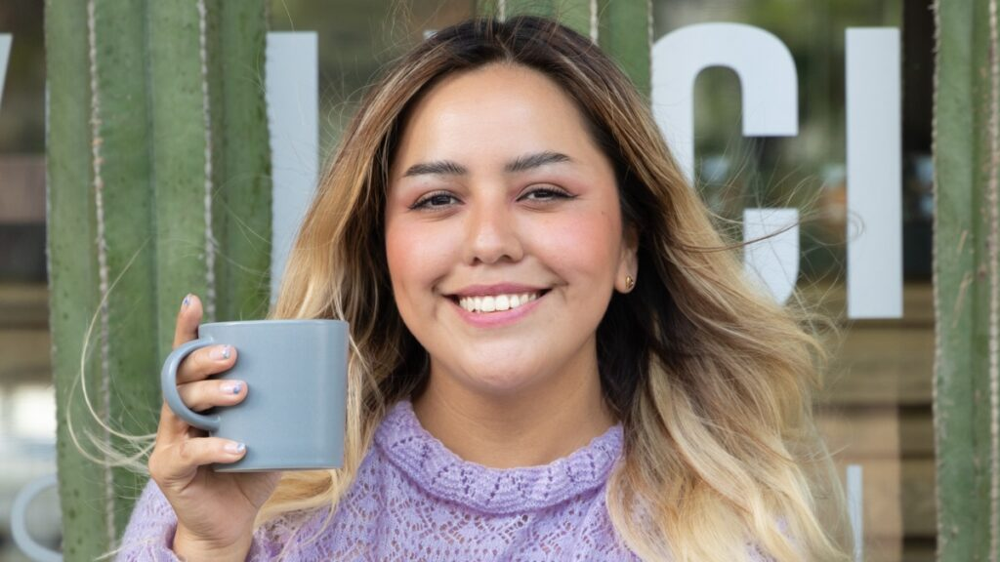

 Tostadora y dueña de Espanglish Coffee Roasters, Campeona Nacional Barista, y Barista Trainer (AST) 

# Premios
## World Barista Championship
2018 | Representante de Mexico en La Competencia Mundial de Baristas Amsterdam

## Competencia Mexicana de Baristas
2016 | 3° Lugar  
__2017__ | __1° Lugar__
2018 | 2° Lugar
2022 | 2° Lugar    
2023 | 3° Lugar  
2025 | 2° Lugar  

## Competencia Mexicana de Coffee in Good Spirits
2025 | 3° Lugar

# Proyectos

## Espanglish Coffee Roasters | 2025-presente
  
Espanglish es mi cafetería y tostaduría de café de especialidad en San Miguel Chapultepec, CDMX (antes Elemento Cafe, mi marca de café tostado desde 2020). Tostamos en sitio, preparamos cualquier bebida con cualquier grano, damos clases de barismo y experiencias de cata.  
Creo que un buen café lo merecemos todos, sin un sobreprecio.  
Más información: [espanglish.cafe](https://espanglish.cafe/es) · [@espanglish_cafe](https://www.instagram.com/espanglish_cafe)  
Para información y pedidos, mándame un correo por [ariadna.chaparro@yahoo.com.mx](mailto:ariadna.chaparro@yahoo.com.mx)

# Collaboraciones
* Oster
* Royal Prestige
* Alpura Selecta
* City Market
* Embajada de Indonesia
* San Remo Coffee Machines

# Experiencia Pasada
* __Constela \| 2019-2025__
  * Barista Trainer, imagen de la marca y Head Roaster de esta cafetería de especialidad
* __Elemento Cafe \| 2020-2025__
  * Marca propia de café tostado, hoy Espanglish
* __San Remo Latin \| 2015-2019__
  * Creación de concepto y gerente de Centro Café
  * Barista Trainer en School of Coffee Matters 
* __Starbucks \| 2011-2015__
  * Barista/marketing campañas de posicionamiento de marca en eventos de patrocinio

# Entrevistas
* [ Chilango ](https://www.chilango.com/comida/a-que-sabe-un-buen-cafe-ariadna-chaparro-campeona-barista-responde/)
* [ Meganoticias ](https://www.meganoticias.mx/tepic/noticia/ariadna-chaparro-barista-campeona-fiel-al-cafe-nacional/39609)
* [ Café de Especialidad Mx ](https://www.youtube.com/watch?v=Uzjo9WceM7k)
* [Food and Wine](https://www.pressreader.com/mexico/food-wine-en-espanol/20190601/282291026815757)
* [Bartista Magazine](https://www.baristamagazine.com/10-minutes-with-mexican-barista-champion-ariadna-chaparro/)
* [El Universal](https://www.eluniversal.com.mx/menu/como-elegir-el-cafe-ideal/)
* [14 Líderes de La Industria Gastronómica](https://www.eluniversal.com.mx/menu/las-mujeres-mexicanas-y-la-alimentacion/)

# Educación

AST | 2017 | Specialty Coffee Association
* Certificación Fundamentos: Green coffee, roast, brewing, sensory 
* Certificación Nivel Profesional: Barista 
