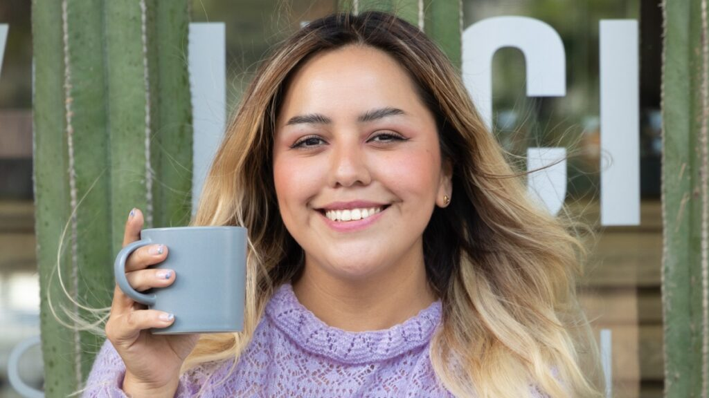

Roaster and owner of Espanglish Coffee Roasters, National Barista Champion and Barista Trainer (AST) 

# Awards
## World Barista Championship
2018 | Mexican Representative at the World Barista Championship in Amsterdam

## Mexican National Barista Competition
2016 | 3rd Place  
__2017__ | __1st Place__  
2018 | 2nd Place  
2022 | 2nd Place  
2023 | 3rd Place  
2025 | 2nd Place  

## Mexican Coffee in Good Spirits Competition
2025 | 3rd Place

# Projects

## Espanglish Coffee Roasters | 2025-present
  
Espanglish is my specialty coffee shop and roastery in San Miguel Chapultepec, Mexico City. We roast on-site, make any drink with any bean, and run barista classes and tasting experiences.  
I believe that everyone deserves a good cup of coffee, without it being expensive.  
More information: [espanglish.cafe](https://espanglish.cafe/) · [@espanglish_cafe](https://www.instagram.com/espanglish_cafe)  
For information and orders, send me an email at [ariadna.chaparro@yahoo.com.mx](mailto:ariadna.chaparro@yahoo.com.mx)

# Collaborations
* Oster
* Royal Prestige
* Alpura Selecta
* City Market
* Embajada de Indonesia
* San Remo Coffee Machines

# Past Experience
* __Constela \| 2019-2025__
  * Barista Trainer, brand image and Head Roaster at this specialty coffee shop
* __[Elemento Cafe](https://www.instagram.com/elementocafe/) \| 2020-2025__
  * Own roasted-coffee brand
* __San Remo Latin \| 2015-2019__
  * Concept creator and manager at Centro Café
  * Barista Trainer at School of Coffee Matters 
* __Starbucks \| 2011-2015__
  * Barista / Brand marketing campaigns at sponsorship events

# Entrevistas
* [ Chilango ](https://www.chilango.com/comida/a-que-sabe-un-buen-cafe-ariadna-chaparro-campeona-barista-responde/)
* [ Meganoticias ](https://www.meganoticias.mx/tepic/noticia/ariadna-chaparro-barista-campeona-fiel-al-cafe-nacional/39609)
* [ Café de Especialidad Mx ](https://www.youtube.com/watch?v=Uzjo9WceM7k)
   [Food and Wine](https://www.pressreader.com/mexico/food-wine-en-espanol/20190601/282291026815757)
* [Bartista Magazine](https://www.baristamagazine.com/10-minutes-with-mexican-barista-champion-ariadna-chaparro/)
* [El Universal](https://www.eluniversal.com.mx/menu/como-elegir-el-cafe-ideal/)
* [14 Leaders of the Food Industry](https://www.eluniversal.com.mx/menu/las-mujeres-mexicanas-y-la-alimentacion/)

# Educación

AST | 2017 | Specialty Coffee Association
* Fundamental Certifications: Green coffee, roast, brewing, sensory 
* Professional Certifications: Barista 

